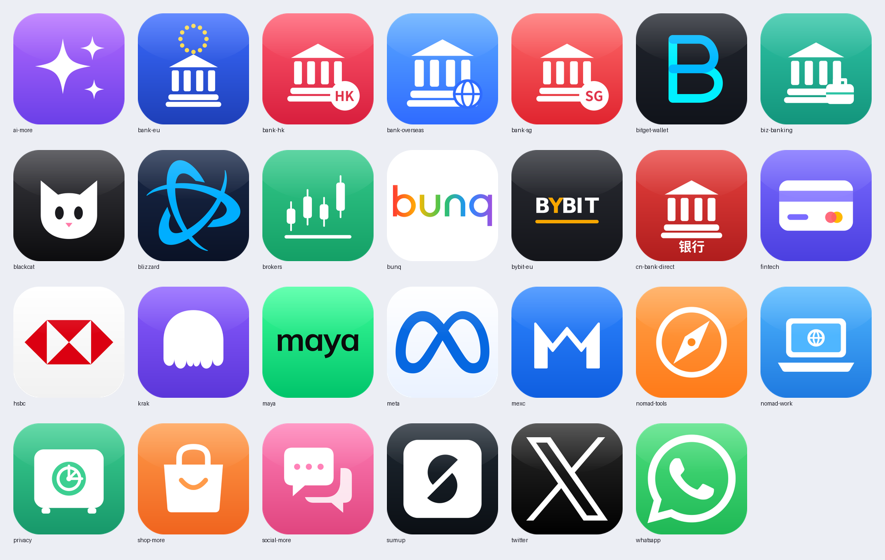

# Lowex-Icons

[Lowex](https://github.com/wenxu184/Lowex) 策略组图标库 / Policy-group icon set for Lowex.

Lowex 生成的配置里，每个服务组（Bunq、Maya、WhatsApp…）可以带一个图标 URL。这个仓库放**经过人工核对**的图标；还没上传的组，Lowex 会用中性占位图 `icons/_placeholder.png`，不会再显示错误品牌的图标。

## 已收录（v1.5，27 个）

品牌类（bunq、SumUp、WhatsApp、HSBC、Battle.net、X、Meta）以 [Simple Icons](https://simpleicons.org)（CC0）的矢量标志为底重绘成圆角方块；Maya、Kraken、Bybit、MEXC、Bitget、Blackcat 为按品牌配色与字标手绘的简化版（非官方原图）；其余是分类通用图标。生成脚本见 `tools/make.py、make2.py、make3.py（依次运行）`（需要 cairosvg）。

## 命名与规格

- 路径：`icons/<组 id>.png`（组 id 见 [`mapping.json`](mapping.json)，例如 `icons/bunq.png`）
- 格式：PNG，**1:1 正方形**，256×256 或 512×512 像素，透明背景
- 内容：只放对应品牌 / 组的标志，不要加文字说明、不要拼其他品牌
- 以 `_` 开头的文件（如 `_placeholder.png`）保留给系统用

## 怎么生效

1. 把 PNG 放进 `icons/` 并推送到 `main`。
2. Lowex App 启动时通过 GitHub API 列出本仓库 `icons/` 里的文件，凡是存在 `<组 id>.png` 的组，生成配置时自动改用
   `https://raw.githubusercontent.com/wenxu184/Lowex-Icons/main/icons/<组 id>.png`；没有的组沿用已核对的旧图或占位图。无需重新发版。
3. [`mapping.json`](mapping.json) 记录每个组当前的核对状态（`ok` / `generic` / `wrong` / `single` / `broken`）和需要什么图标；完整待办见 Lowex 仓库的 [docs/ICONS-TODO.md](https://github.com/wenxu184/Lowex/blob/main/docs/ICONS-TODO.md)。

## 许可与商标 / License & trademarks

- 本仓库的说明文档与脚本：MIT（见 `LICENSE`）。
- 图标中的品牌标志是各自权利人的商标，仅用于识别对应服务（指称性使用）。**只上传你有权使用 / 官方允许用于识别用途的素材**；权利人要求下架时会删除。
- Brand logos are trademarks of their respective owners and are used only to identify the service. Upload only assets you are entitled to use.
